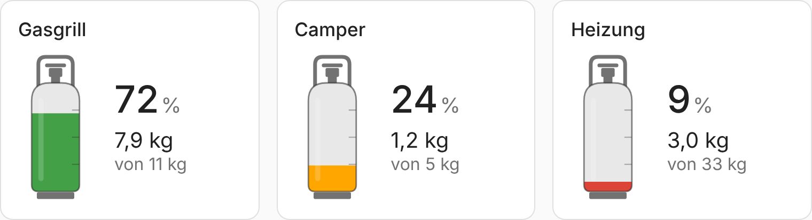
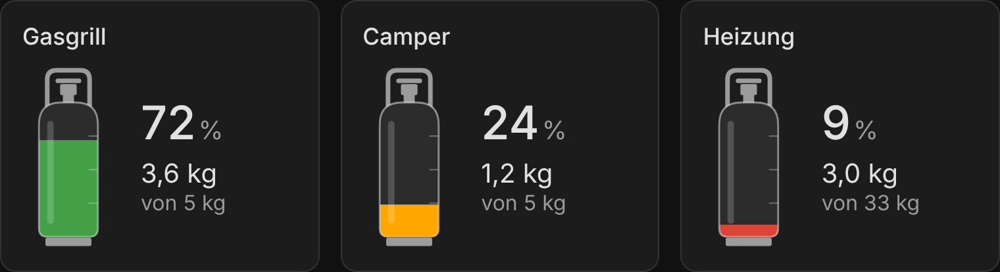

# Gas Bottle Card

[](https://hacs.xyz/)
[](https://github.com/<OWNER>/gas-bottle-card/actions/workflows/validate.yml)

Eine Lovelace-Card für Home Assistant, die den Füllstand einer Gasflasche grafisch darstellt.
Die Entität liefert den Füllstand in Prozent – die Card berechnet daraus zusammen mit dem
eingestellten Gesamtvolumen die verbleibende Gasmenge in kg.





## Funktionen

- Gasflasche als SVG-Grafik mit animiertem Füllstand
- Restmenge in kg = Füllstand (%) × Gesamtvolumen (kg)
- Farbwechsel grün → gelb → rot über einstellbare Schwellwerte
- Neutrales Design, passt sich automatisch an das aktive Theme (hell/dunkel) an
- Visueller Editor – keine YAML-Kenntnisse nötig
- Klick öffnet den Detaildialog der Entität
- Unterstützt das Sections-Dashboard (Grid-Layout)
- Deutsch und Englisch

## Installation

### Über HACS (empfohlen)

1. In Home Assistant **HACS** öffnen.
2. Oben rechts auf **⋮ → Benutzerdefinierte Repositories** klicken.
3. Repository-URL `https://github.com/<OWNER>/gas-bottle-card` eintragen und als Typ
   **Dashboard** auswählen.
4. Nach **Gas Bottle Card** suchen und **Herunterladen** klicken.
5. Browser neu laden (ggf. Cache leeren).

HACS trägt die Ressource `/hacsfiles/gas-bottle-card/gas-bottle-card.js` automatisch ein.

### Manuell

1. `dist/gas-bottle-card.js` nach `/config/www/gas-bottle-card.js` kopieren.
2. **Einstellungen → Dashboards → ⋮ → Ressourcen → Ressource hinzufügen**
   - URL: `/local/gas-bottle-card.js`
   - Typ: **JavaScript-Modul**
3. Browser neu laden.

## Konfiguration

Die Card kann im Dashboard über **Karte hinzufügen → Gas Bottle Card** komplett im visuellen
Editor eingerichtet werden. Alternativ per YAML:

```yaml
type: custom:gas-bottle-card
entity: sensor.gasflasche_fuellstand
name: Gasgrill
capacity: 11
warning: 30
critical: 15
```

| Option     | Typ    | Standard                | Beschreibung                                         |
| ---------- | ------ | ----------------------- | ---------------------------------------------------- |
| `entity`   | string | **erforderlich**        | Entität, die den Füllstand in Prozent (0–100) liefert |
| `name`     | string | Anzeigename der Entität | Überschrift der Card                                 |
| `capacity` | number | `11`                    | Gesamtvolumen der Flasche in kg                      |
| `warning`  | number | `30`                    | Ab diesem Füllstand (%) und darunter: gelb           |
| `critical` | number | `15`                    | Ab diesem Füllstand (%) und darunter: rot            |

Werte außerhalb von 0–100 % werden auf diesen Bereich begrenzt. Ist die Entität nicht
verfügbar, zeigt die Card einen entsprechenden Hinweis an.

### Farben anpassen

Die Card verwendet die Theme-Variablen `--success-color`, `--warning-color` und
`--error-color` für den Füllstand sowie `--secondary-background-color` und
`--secondary-text-color` für Flasche und Ventil. Über ein Theme lassen sich diese zentral
ändern.

## Demo

`demo/index.html` im Browser öffnen, um die Card ohne Home Assistant auszuprobieren
(Schieberegler für Füllstand, Gesamtvolumen, helles/dunkles Theme).

## Neue Version veröffentlichen

1. `CARD_VERSION` in `dist/gas-bottle-card.js` erhöhen und committen.
2. Tag anlegen und pushen, z. B.:
   ```bash
   git tag v1.0.1
   git push origin v1.0.1
   ```
3. Die GitHub Action erstellt automatisch ein Release mit der JS-Datei. HACS zeigt das Update
   anschließend an.

## Lizenz

[MIT](LICENSE)
